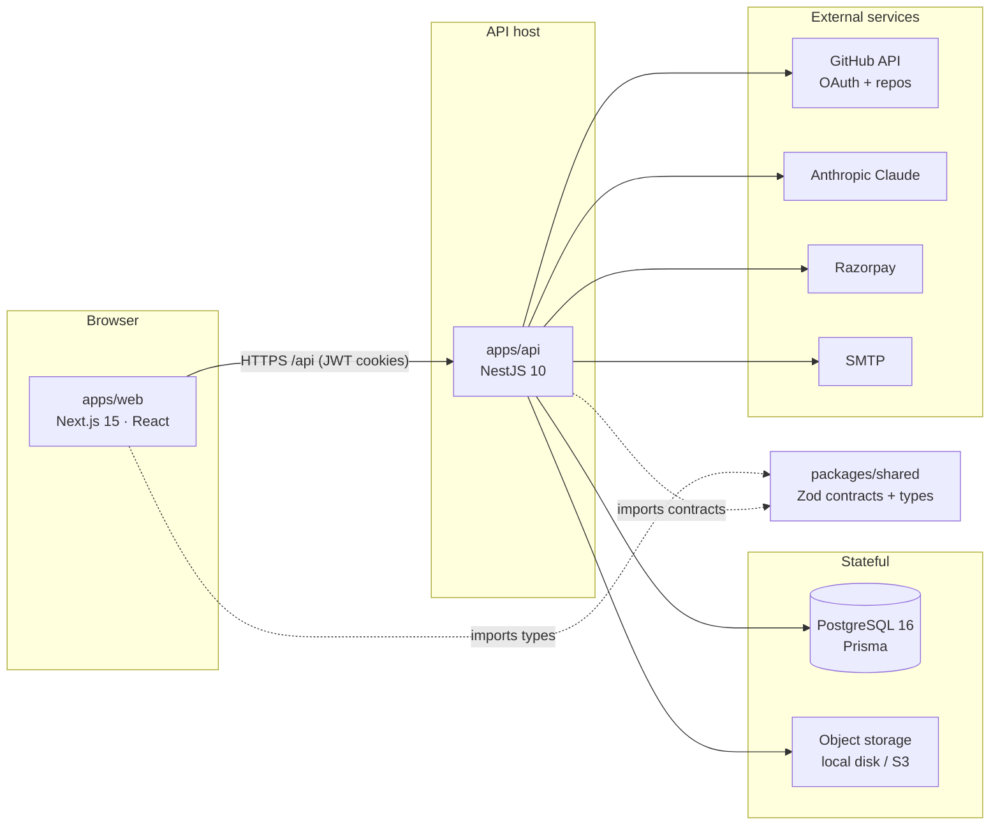
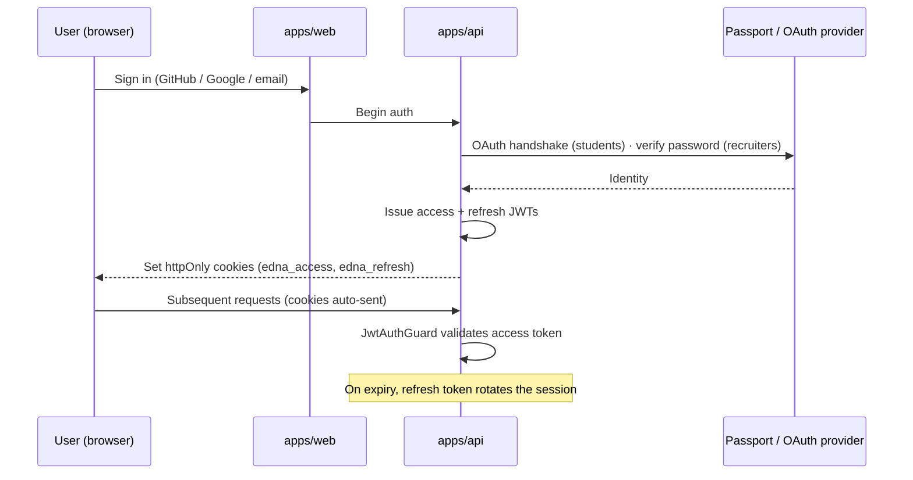
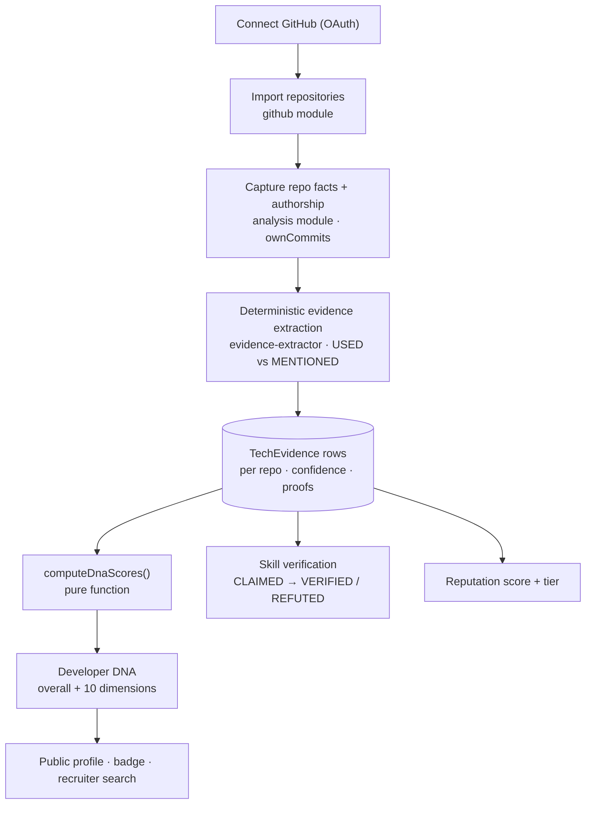
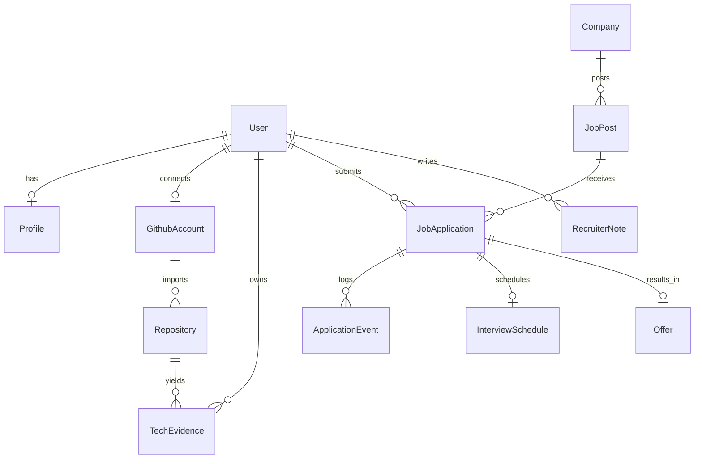
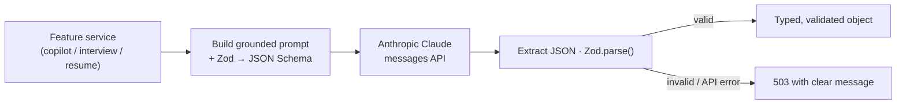

<div align="center">

# 🧬 EngineerDNA

### Hire engineers on **verified engineering evidence** — not resume claims.

EngineerDNA reads a developer's **real public code**, turns it into a verified skill profile
("Developer DNA"), and gives recruiters an evidence-backed way to search, rank, and hire —
so every claimed skill is provable, not asserted.

<br/>

[](.github/workflows/ci.yml)
[](LICENSE)
[](https://www.typescriptlang.org/)
[](https://nextjs.org/)
[](https://nestjs.com/)
[](https://www.prisma.io/)
[](https://www.postgresql.org/)
[](https://turbo.build/)
[](https://pnpm.io/)

</div>

---

## 📑 Table of Contents

- [Screenshots / Demo](#-screenshots--demo)
- [Problem Statement](#-problem-statement)
- [Key Features](#-key-features)
- [Full Module Reference](#-full-module-reference)
- [Tech Stack](#-tech-stack)
- [Architecture](#-architecture)
- [Folder Structure](#-folder-structure)
- [Installation](#-installation)
- [Environment Variables](#-environment-variables)
- [Docker](#-docker)
- [Development Workflow](#-development-workflow)
- [Available Scripts](#-available-scripts)
- [Database Design](#-database-design)
- [API Overview](#-api-overview)
- [Authentication](#-authentication)
- [AI Pipeline](#-ai-pipeline)
- [Engineering DNA & Evidence](#-engineering-dna--evidence)
- [Security](#-security)
- [Performance & Caching](#-performance--caching)
- [Design Decisions](#-design-decisions)
- [Roadmap](#-roadmap)
- [Contributing](#-contributing)
- [Code Style](#-code-style)
- [Testing](#-testing)
- [Deployment](#-deployment)
- [Troubleshooting](#-troubleshooting)
- [FAQ](#-faq)
- [License](#-license)
- [Author](#-author)

---

## 📸 Screenshots / Demo

> **Note**
> Screenshots are not yet committed to the repository. The placeholders below map to real, implemented pages
> (routes verified in `apps/web/src/app`). Replace them with real captures before publishing.

| Surface | Route | Description |
| --- | --- | --- |
| Developer DNA dashboard | `/dashboard`, `/dna` | Score ring, 10-dimension radar, hiring-readiness, application funnel |
| Verified public profile | `/u/[username]` | Shareable evidence profile + QR + printable one-pager (`/u/[username]/print`) |
| Recruiter — Find Talent | `/recruiter` | Evidence-based candidate search with filters, sorting, comparison |
| Recruiter — Analytics | `/recruiter/analytics` | Hiring funnel, conversion rates, per-job breakdown |
| Hiring pipeline | `/recruiter/jobs/[id]` | Kanban board, interview scheduling, offers, per-application timeline |

To populate every screen with realistic data before recording a demo:

```bash
pnpm db:seed
```

---

## 🎯 Problem Statement

### The problem

Technical hiring runs on **unverifiable signals**. A résumé that says "expert in Kubernetes" is a claim, not
proof. A LeetCode streak proves you can solve puzzles, not that you can ship. A keyword-matching ATS rewards
resume-writing skill, not engineering skill. As a result:

- **Strong candidates with quiet resumes get filtered out**, even when their public GitHub work proves real
  ability — nobody is reading the code.
- **Recruiters can't tell a real skill from a buzzword** without a live technical screen, so every candidate
  costs the same amount of trust-building time regardless of how much proof already exists in public.
- **Candidates have no good way to prove what they've actually built.** A portfolio link sits unread; a
  résumé bullet is taken on faith either way.

### Why we built this

The one thing a working developer already has — and can't fake — is **real code they've written and pushed
publicly**. That code already contains the answer to "can this person actually do the job": which
technologies they've genuinely implemented, how deep that implementation goes, and how it's evolved over
time. Nobody was turning that evidence into something recruiters could search and candidates could point to.
EngineerDNA does exactly that.

### What EngineerDNA does

A developer connects their GitHub account once. From that point on, EngineerDNA:

1. **Reads their public repositories** and separates technology that's genuinely **implemented** from
   technology that's merely **mentioned** in a README or config file.
2. **Scores their engineering ability** across ten real dimensions (backend, frontend, cloud, devops,
   AI/ML, database, API design, security, testing, system design) — a *Developer DNA* profile built entirely
   from that evidence.
3. **Turns every verified skill into a traceable claim** — each one links back to the exact repositories
   that prove it, so nothing is asserted without a receipt.
4. **Publishes a shareable, recruiter-facing profile** — a link, an embeddable badge, a QR code, and a
   printable one-pager — that a candidate can put on a résumé, LinkedIn, or a business card.
5. **Gives recruiters an evidence-first hiring workflow** — search and rank candidates by proven skill, run
   the full pipeline (shortlist → interview → offer → hire) against that evidence, and see analytics on how
   it's converting — instead of sorting résumés by keyword density.

### Who it's for and how it helps them

| Audience | The problem they have today | How EngineerDNA helps |
| --- | --- | --- |
| **Candidates / students** | Real skill built through side projects and open source goes unnoticed next to a polished résumé. | Public work is turned into a verified score and a shareable profile that speaks for itself — plus a career copilot and a learning roadmap grounded in *their own* evidence, not generic advice. |
| **Recruiters / hiring teams** | Screening resumes for real ability is slow, and keyword filters miss good candidates and let bad matches through. | Search and rank by **proven** skills with a fully explainable score, compare candidates side by side, and run the entire hiring pipeline against evidence that's already been checked. |

> **Warning**
> EngineerDNA analyzes **public repositories only**. Private repositories are never read, rolled up, or
> exposed to recruiters — this is a core trust guarantee enforced throughout the evidence layer.

---

## ✨ Key Features

Every feature below explains **what it does for the user** and **how it's actually implemented** — not just
a checklist. Each is backed by a NestJS module in `apps/api/src` and a route in `apps/web/src/app`.

<details open>
<summary><b>🎓 Candidate side — turn real code into a verified profile</b></summary>

<br/>

**GitHub import & repository analysis** (`github`, `analysis`)
Connect once with GitHub OAuth to import your repositories. Each repo's authorship is checked
(`ownCommits`), so a fork you never actually contributed to can't inflate your evidence — only work you
personally wrote counts.

**Evidence Engine — the core trust mechanism** (`evidence`)
A **deterministic** analyzer (no AI guesswork) scans each repository and classifies every technology it finds
as either **`USED`** — genuinely implemented in real code — or **`MENTIONED`** — referenced but not proven.
Each classification carries a confidence score and concrete proof references, stored per repository. This is
the layer that makes every downstream score auditable and reproducible.

**Developer DNA — your engineering profile, quantified** (`dna`)
A pure scoring function turns that evidence into one overall score and **ten dimension scores** — backend,
frontend, cloud, devops, AI/ML, database, API design, security, testing, and system design — so instead of a
single vague number, you get a profile that shows exactly where your strengths and gaps are.

**Skill verification** (`verification`)
Skills you claim on your profile are reconciled against your evidence and move through a real lifecycle:
`CLAIMED → VERIFYING → VERIFIED` (or `REFUTED` if the evidence doesn't back it up) — so a "skill" on your
profile means something specific, not just a tag you typed in.

**Reputation** (`reputation`)
An aggregate trust score and tier computed from your verified evidence — a single number recruiters can use
as a fast, honest signal.

**AI Career Copilot** (`copilot`)
A mentor chat that answers questions like *"Am I ready for backend internships?"* or *"What should I build
next?"* — grounded **only** in your actual DNA scores, reputation, evidence, and computed career data, so the
advice is specific to you instead of generic.

**AI mock interviews with live proctoring** (`interview`)
Practice with generated interview questions and get your answers evaluated, while in-browser proctoring
(MediaPipe face landmarks + TensorFlow.js object detection) tracks integrity signals — tab switches, face
presence, phone detection — and produces a proctoring report recruiters can trust.

**Resume review** (`resume`)
Upload a résumé (parsed entirely client-side) and get it reviewed against your real profile.

**Learning roadmap & curated resources** (`roadmap`, `/resources`)
Recommendations are keyed directly to your **weakest** DNA dimensions — so instead of a generic course list,
you get pointed at exactly what would move your profile forward.

**Open-source finder** (`oss`)
Surfaces good-first-issue-style contribution opportunities so you can build evidence in areas you're weak in.

**Portfolio & shareable verified profile** (`portfolio`, `public`)
A public profile at `/u/<username>` you can send to any recruiter, an embeddable SVG verification badge for a
GitHub README, a scannable QR code, and a print-ready one-page PDF — every format a candidate actually needs
to share proof of their work.

</details>

<details>
<summary><b>🏢 Recruiter side — hire on proof, not keywords</b></summary>

<br/>

**Evidence-based talent search** (`recruiter`)
Search verified candidates by skills that are **proven in public code** — not resume keywords — with filters
for minimum DNA score, verified-skill count, experience, and location, and five sort orders to surface the
best-fit candidates first.

**Candidate comparison**
Select up to four ranked candidates and see their evidence, scores, and matched skills side by side, so a
hiring decision is a comparison of proof, not gut feel.

**Transparent candidate ranking**
Candidates are ranked by a weighted composite of evidence strength, skill match, and interview signal — and
critically, **every factor shows its own score, weight, and reasoning**, so a rank is never a black box.

**Job posts & evidence-backed applications** (`jobs`, applications)
Post roles, receive applications with a fresh résumé per application, and see a match report for each
applicant that explains exactly which required skills are proven in their code versus just claimed.

**Full hiring lifecycle**
A real ATS pipeline (`APPLIED → VIEWED → SCREENING → SHORTLISTED → INTERVIEW_SCHEDULED → OFFER_SENT →
OFFER_ACCEPTED → HIRED`, plus `REJECTED`) with a drag-and-drop Kanban board, interview scheduling, offer
management, and an append-only timeline on every application — so nothing about a hiring decision is lost.

**Private notes & candidate rating**
Recruiters can leave a private note and a 1–5 rating on any candidate — visible only to them, never to the
candidate — to track impressions across a long hiring process.

**Hiring analytics** (`/recruiter/analytics`)
See the funnel distribution, stage-to-stage conversion rates, average days-to-hire, and a per-job breakdown —
so a recruiting team can see what's actually working, not just individual applications.

**Subscriptions & billing** (`payments`)
Razorpay-backed recruiter subscriptions gate access to the recruiter feature set.

**Gated, spam-proof messaging** (`messaging`)
A recruiter can invite a candidate to chat, but the conversation only unlocks once the candidate accepts —
protecting candidates from being spammed while still enabling direct outreach.

</details>

---

## 🧩 Full Module Reference

The backend was built **module by module**, and each module's own source comment states its number and
purpose — this table is a complete, verified inventory of all of them, in build order. Every module is a
self-contained NestJS module (`apps/api/src/<name>`) with its own controller and service.

<details open>
<summary><b>Modules 1–10 — Foundation, identity, and evidence</b></summary>

| # | Module | What it does |
| :-: | --- | --- |
| 1 | **Foundation** | Turborepo monorepo, Docker, CI/CD — the base every other module builds on. |
| 2 | **Authentication** (`auth`) | GitHub/Google OAuth for candidates, email/password for recruiters, JWT access + refresh tokens, role guards. |
| 3 | **Engineering Passport** (`profile`, `users`) | The developer's editable identity profile — headline, about, location, socials, hiring signals (availability, expected salary). |
| 4 | **GitHub Integration** (`github`) | OAuth token exchange, repository import, per-repo selection for analysis. |
| 5 | **Repository Analysis Engine** (`analysis`) | Generates an engineering report for each repository from its structural facts. |
| 6 | **Evidence Engine** (`evidence`) | The deterministic "truth layer" — classifies every technology per repo as `USED` or `MENTIONED` with confidence + proofs. **No LLM.** |
| 7 | **Skill Verification Engine** (`verification`) | Reconciles a developer's claimed skills against Module 6 evidence: `CLAIMED → VERIFYING → VERIFIED / REFUTED`. |
| 8 | **Developer DNA Engine** (`dna`) | Deterministic scoring of overall + 10 engineering dimensions from evidence. **No LLM.** |
| 9 | **Project Intelligence** (`project`) | Scores an individual repository's quality across dimensions, combining Module 5's report and Module 6's evidence. **No LLM.** |
| 10 | **Career Intelligence** (`career`) | Deterministic career archetype, realistic role matches, and skill-gap analysis from the DNA profile. **No LLM.** |

</details>

<details open>
<summary><b>Modules 11–20 — AI surfaces, hiring, and the capstone</b></summary>

| # | Module | What it does |
| :-: | --- | --- |
| 11 | **AI Interview Engine** (`interview`) | Generates and evaluates mock technical interviews from the developer's verified profile, with proctoring integrity signals. |
| 12 | **Resume Intelligence** (`resume`) | Reviews an uploaded résumé against the developer's actual verified profile. |
| 13 | **Learning Roadmap** (`roadmap`) | Generates a learning path toward a target role, tracking progress against gaps. |
| 14 | **Recruiter Dashboard** (`recruiter`) | Searches verified public candidate profiles by required skills; gated by an active recruiter subscription. |
| 15 | **Candidate Ranking Engine** (`recruiter` / shared `ranking` contract) | Ranks candidates for a job on a transparent, weighted composite of evidence factors — every factor shows its score, weight, and reasoning. **No LLM.** |
| 16 | **Engineering Timeline** (`timeline`) | A chronological growth journey built live from Module 6 evidence — when each skill/technology first appeared. |
| 17 | **Open Source Recommendation** (`oss`) | Matches verified skills to real GitHub "good first issue"-style contribution opportunities. |
| 18 | **Portfolio Generator** (`portfolio`) | One LLM call extracts a structured portfolio (projects, highlights) from the verified profile for a public portfolio page. |
| 19 | **Engineering Reputation Score** (`reputation`) | A fair aggregate score/tier computed purely from verified signals. |
| 20 | **AI Career Copilot** (`copilot`) — *capstone* | Unifies every verified store (DNA, evidence, reputation, career) into one mentor chat, grounded only in that data. |

</details>

<details>
<summary><b>Beyond Module 20 — the two-sided hiring platform</b></summary>

Built after the capstone module to turn the verified-identity product into a complete hiring platform for
both sides of the market.

| Area | Module(s) | What it does |
| --- | --- | --- |
| **Job board & applications** | `jobs`, `applications` | Recruiters post roles; candidates browse, search, and apply with a résumé + cover letter per application. |
| **Evidence-backed match report** | `applications` (`recruiter.buildApplicant` / `matchReport`) | For each applicant, computes which required skills are evidence-proven vs. resume-only vs. missing, plus matched repositories. |
| **Hiring lifecycle** | `applications` (lifecycle endpoints) | Full ATS pipeline with interview scheduling (`InterviewSchedule`), offer management (`Offer`), and an append-only per-application timeline (`ApplicationEvent`). |
| **Candidate comparison** | `apps/web` recruiter UI | Side-by-side comparison of up to four ranked candidates' scores, evidence, and matched skills. |
| **Recruiter private notes & rating** | `recruiter` (note endpoints) | A private note + 1–5 rating per candidate, visible only to the recruiter who wrote it. |
| **Recruiter hiring analytics** | `recruiter` (`analytics` endpoint) | Aggregated funnel distribution, stage-conversion rates, average days-to-hire, and per-job breakdown. |
| **Advanced talent search** | `apps/web` recruiter UI | Client-side filters (DNA score, verified-skill count, experience, location) and five sort orders over search results. |
| **Public company profiles** | `public` (company endpoints) | A public, shareable company page listing open roles — the recruiter-side counterpart to the candidate's verified profile. |
| **Verified-profile sharing** | `public`, `portfolio` | Public profile (`/u/[username]`), embeddable SVG badge, scannable QR code, and a print-ready PDF one-pager. |
| **Messaging** | `messaging` | Recruiter-initiated, candidate-gated chat with file attachments, unread counts, and real-time polling. |
| **Notifications** | `notifications` | In-app notifications for application status changes, invitations, interviews, and offers. |
| **Recruiter billing** | `payments` | Razorpay-backed recruiter subscriptions with plan limits, gating the entire recruiter feature set. |
| **Transactional email** | `mail` | SMTP-based emails for application confirmations and status changes (logs instead of sending when unconfigured). |
| **Object storage** | `storage` | Pluggable local-disk / S3 file storage for chat attachments (and, going forward, résumés and interview recordings). |
| **SEO / shareability** | `apps/web` (`generateMetadata`) | Per-request OpenGraph and Twitter-card metadata for public profile and company pages, so shared links render rich previews. |
| **Demo data** | `prisma/seed.mjs` | An idempotent seed script that populates a full, coherent hiring story (recruiter, company, verified candidates, a complete funnel) for demos. |

</details>

---

## 🧰 Tech Stack

> Every entry below is present in the project's `package.json` files or configuration — nothing aspirational.

| Category | Technologies |
| --- | --- |
| **Language** | TypeScript (strict), shared `tsconfig.base.json` |
| **Frontend** | Next.js 15 (App Router), React 19, Tailwind CSS, `tailwindcss-animate`, `class-variance-authority`, `clsx`, `tailwind-merge`, Zustand (state), `lucide-react` (icons) |
| **Frontend AI / media** | `@mediapipe/tasks-vision` (face landmarks), `@tensorflow/tfjs` + `@tensorflow-models/coco-ssd` (object detection for proctoring), `pdfjs-dist` + `mammoth` (client-side résumé parsing), `html2canvas`, `qrcode` |
| **Backend** | NestJS 10, Express platform, RxJS |
| **ORM / DB** | Prisma 5, PostgreSQL 16 |
| **AI** | `@anthropic-ai/sdk` (Claude); default models `claude-opus-4-8` (analysis) and `claude-haiku-4-5` (fast path) |
| **Auth** | `@nestjs/jwt`, Passport (`passport-github2`, `passport-google-oauth20`, `passport-jwt`), scrypt password hashing (Node `crypto`) |
| **Validation** | Zod (shared contracts), `zod-to-json-schema`, `class-validator` / `class-transformer` |
| **Object storage** | Local disk **or** AWS S3 (`@aws-sdk/client-s3`, `@aws-sdk/s3-request-presigner`) — driver selectable by env |
| **Payments** | Razorpay |
| **Email** | Nodemailer (SMTP; logs instead of sends when unconfigured) |
| **Security** | Helmet, `cookie-parser`, `@nestjs/throttler` (rate limiting), AES-256-GCM token encryption |
| **Infrastructure** | Docker, Docker Compose (PostgreSQL, Redis, Neo4j, api, web) |
| **Monorepo tooling** | Turborepo 2, pnpm 9 workspaces |
| **CI** | GitHub Actions (install → build → lint → test) |
| **Testing** | Jest + ts-jest (API unit tests) |

> **Note**
> **Redis** and **Neo4j** are provisioned in `docker-compose.yml` and declared in `.env.example` as the
> intended scale path, but they are **not yet wired into application code** (no client libraries are present
> in the API dependencies). Today, PostgreSQL is the single system of record and caching is in-process
> (see [Performance & Caching](#-performance--caching)). This README does not claim otherwise.

---

## 🏗 Architecture

EngineerDNA is a **Turborepo monorepo** with three workspaces and a strict, one-directional dependency rule:
both applications depend on the shared contracts package; the frontend talks to the backend only over HTTP.



**Backend design.** The API is organized into ~31 **feature modules** (`auth`, `github`, `evidence`, `dna`,
`recruiter`, `applications`, `interview`, …), each a self-contained NestJS module with its own
controller(s) and service(s). Cross-cutting concerns are provided globally: `PrismaModule` (data),
`StorageModule` (files), `MailModule` (email), and `ConfigModule` (configuration). This is a pragmatic
**clean-architecture** layering — controllers handle HTTP, services hold business logic, Prisma is the data
gateway — with **dependency injection** wiring throughout.

**Type-safe contract layer.** `packages/shared` exports Zod schemas that are the single source of truth for
request/response shapes. The backend validates inbound payloads against these schemas (via a
`ZodValidationPipe`) and the frontend imports the inferred types — so a contract change surfaces as a compile
error on both sides.

### Authentication flow



### Evidence → DNA pipeline



> **Important**
> The **evidence extraction and DNA scoring are deterministic** — they do not call an LLM. Claude is used for
> the *narrative* surfaces (career copilot, interviews, résumé review), not for deciding whether a skill is
> verified. This keeps the trust-critical path reproducible and auditable.

---

## 📂 Folder Structure

```text
EngineerDNA/
├── apps/
│   ├── api/                     # NestJS backend
│   │   ├── prisma/
│   │   │   ├── schema.prisma     # 27 models · 15 enums
│   │   │   ├── migrations/       # SQL migrations (ordered)
│   │   │   └── seed.mjs          # idempotent demo seed
│   │   ├── src/
│   │   │   ├── auth/             # OAuth, JWT, guards, password hashing
│   │   │   ├── github/           # GitHub OAuth + repo import
│   │   │   ├── analysis/         # repository facts
│   │   │   ├── evidence/         # deterministic evidence engine
│   │   │   ├── dna/              # Developer DNA scoring
│   │   │   ├── verification/     # claimed-vs-evidence skill status
│   │   │   ├── reputation/       # trust score/tier
│   │   │   ├── interview/        # AI interviews + proctoring
│   │   │   ├── resume/           # résumé review
│   │   │   ├── career/ copilot/  # career intelligence + AI mentor
│   │   │   ├── roadmap/ oss/     # learning roadmap, OSS finder
│   │   │   ├── jobs/ applications/ recruiter/  # hiring domain
│   │   │   ├── messaging/ notifications/       # comms
│   │   │   ├── payments/         # Razorpay subscriptions
│   │   │   ├── portfolio/ public/# portfolios + public profiles/badges
│   │   │   ├── llm/              # Anthropic wrapper
│   │   │   ├── storage/          # local/S3 file storage
│   │   │   ├── mail/ prisma/ common/ health/ users/ profile/
│   │   │   └── main.ts           # bootstrap (helmet, CORS, pipes, /api prefix)
│   │   └── Dockerfile
│   └── web/                      # Next.js frontend (App Router)
│       ├── src/app/              # routes (dashboard, dna, recruiter, u/[username], …)
│       ├── src/components/ services/ hooks/ lib/
│       └── Dockerfile
├── packages/
│   └── shared/                   # Zod contracts + shared TypeScript types
├── docker-compose.yml            # postgres · redis · neo4j · api · web
├── turbo.json                    # Turborepo task graph
├── pnpm-workspace.yaml
├── tsconfig.base.json
├── scripts/                      # start.sh · stop.sh · reset.sh
├── docs/                         # ARCHITECTURE.md · PROJECT_CONTEXT.md
└── .github/workflows/ci.yml
```

---

## 🚀 Installation

### Prerequisites

| Requirement | Version | Notes |
| --- | --- | --- |
| Node.js | `>= 20` | Declared in root `package.json` engines |
| pnpm | `9.x` | `corepack enable` installs the pinned version |
| Docker + Docker Compose | latest | For the one-command local stack |
| PostgreSQL | 16 | Provided by Docker Compose (or bring your own) |

### 1. Clone

```bash
git clone https://github.com/kuldeep31016/EngineerDNA.git
cd EngineerDNA
```

### 2. Configure environment

```bash
cp .env.example .env
# then fill in the values you need (see the Environment Variables table)
```

### 3a. Run everything with Docker (recommended)

```bash
docker compose up --build
```

This starts PostgreSQL, Redis, Neo4j, the API (`:4000`), and the web app (`:3000`).

### 3b. Run locally without Docker

```bash
corepack enable
pnpm install

# start just the database (or point DATABASE_URL at your own Postgres)
pnpm db:up

# apply migrations, then optionally seed demo data
pnpm db:migrate
pnpm db:seed        # optional — loads a full demo dataset

pnpm dev            # runs api + web (+ shared watch) via Turborepo
```

| Service | URL |
| --- | --- |
| Web app | http://localhost:3000 |
| API (prefixed `/api`) | http://localhost:4000/api |
| Neo4j browser (infra) | http://localhost:7474 |

---

## 🔐 Environment Variables

Copy `.env.example` → `.env`. The application runs on sensible local defaults; external integrations are
optional and degrade gracefully (e.g. email logs instead of sends when SMTP is unset).

| Variable | Required | Description |
| --- | :---: | --- |
| `WEB_PORT` / `API_PORT` | ● | Ports for the web (3000) and API (4000) apps. |
| `WEB_ORIGIN` | ● | Origin the API trusts for CORS (the web app). |
| `NEXT_PUBLIC_API_URL` | ● | Browser-facing API base URL (e.g. `http://localhost:4000/api`). |
| `API_PUBLIC_URL` | ● | Public base URL of the API, used to build OAuth callbacks. |
| `NEXT_PUBLIC_APP_URL` | ○ | Public web URL, used for absolute OpenGraph / share links. |
| `POSTGRES_USER` / `POSTGRES_PASSWORD` / `POSTGRES_DB` | ● | PostgreSQL credentials (Docker). |
| `DATABASE_URL` | ● | Prisma connection string. |
| `REDIS_URL` | ○ | Provisioned for the scale path; **not consumed by app code yet.** |
| `NEO4J_URI` / `NEO4J_USER` / `NEO4J_PASSWORD` | ○ | Provisioned for the scale path; **not consumed by app code yet.** |
| `JWT_SECRET` | ● | Signing secret for access/refresh JWTs. |
| `JWT_ACCESS_EXPIRES_IN` / `JWT_REFRESH_EXPIRES_IN` | ○ | Token lifetimes (defaults `15m` / `7d`). |
| `ENCRYPTION_KEY` | ○ | AES-256-GCM key for encrypting stored GitHub tokens; derived from `JWT_SECRET` if blank. |
| `GITHUB_CLIENT_ID` / `GITHUB_CLIENT_SECRET` | ○ | GitHub OAuth (candidate sign-in + repo import). |
| `GOOGLE_CLIENT_ID` / `GOOGLE_CLIENT_SECRET` | ○ | Google OAuth (candidate sign-in). |
| `ANTHROPIC_API_KEY` | ○¹ | Enables all AI features (copilot, interviews, résumé review). |
| `ANTHROPIC_MODEL` / `ANTHROPIC_FAST_MODEL` | ○ | Override default Claude models. |
| `STORAGE_DRIVER` | ○ | `local` (default) or `s3`. |
| `AWS_REGION` / `AWS_S3_BUCKET` / `AWS_ACCESS_KEY_ID` / `AWS_SECRET_ACCESS_KEY` | ○² | Required when `STORAGE_DRIVER=s3`. |
| `AWS_S3_PUBLIC_URL` / `AWS_S3_ENDPOINT` | ○ | Optional CDN URL / S3-compatible endpoint (R2, MinIO, Spaces). |
| `RAZORPAY_KEY_ID` / `RAZORPAY_KEY_SECRET` | ○ | Recruiter subscription payments. |
| `SMTP_HOST` / `SMTP_PORT` / `SMTP_USER` / `SMTP_PASS` / `SMTP_SECURE` / `SMTP_FROM` | ○ | Transactional email; logs to console if unset. |
| `WEB_URL` | ○ | Base URL used inside email links. |

<sub>¹ Optional to boot the app, but AI endpoints return a clear `503` until a valid key is set. ² The S3 driver
falls back to local disk if credentials are incomplete.</sub>

> **Warning**
> `.env` is git-ignored. Never commit real secrets. `.env.example` documents every variable with safe placeholders.

---

## 🐳 Docker

`docker-compose.yml` defines a complete local stack with health checks and named volumes.

| Service | Image | Port(s) | Role |
| --- | --- | --- | --- |
| `postgres` | `postgres:16-alpine` | 5432 | System of record (Prisma). |
| `redis` | `redis:7-alpine` | 6379 | Provisioned for the scale path (not yet consumed by app code). |
| `neo4j` | `neo4j:5-community` | 7474 / 7687 | Provisioned for the scale path (not yet consumed by app code). |
| `api` | built from `apps/api/Dockerfile` | 4000 | NestJS backend; waits for healthy `postgres`/`redis`/`neo4j`. |
| `web` | built from `apps/web/Dockerfile` | 3000 | Next.js frontend; depends on `api`. |

```bash
docker compose up --build      # build + start the whole stack
docker compose up -d postgres  # just the database (used by pnpm db:up)
docker compose down            # stop
```

---

## 🛠 Development Workflow

EngineerDNA is built **module by module**. Each backend module is independently buildable and adds one
capability; the data flow stays one-directional (evidence → DNA → downstream surfaces read from it).

1. **Branch** off `main`.
2. **Change contracts first** — if a request/response shape changes, update `packages/shared` and rebuild it
   so both apps see the new types.
3. **Implement** the backend module and the web surface.
4. **Verify locally** with the full gate:
   ```bash
   pnpm build && pnpm lint && pnpm test
   ```
5. **Open a PR** to `main` — CI runs the same gate.

> **Tip**
> Turborepo enforces build order (`shared → api → web`) and caches task outputs, so incremental runs are fast.

---

## 📜 Available Scripts

Run from the repository root. Turborepo fans these out across workspaces.

| Command | What it does |
| --- | --- |
| `pnpm dev` | Run all apps in watch mode (`shared` watch + `api` + `web`). |
| `pnpm build` | Build in dependency order: shared → api → web. |
| `pnpm lint` | Lint every package (`eslint` for api, `next lint` for web, `tsc --noEmit` for shared). |
| `pnpm test` | Run all test suites (API Jest units). |
| `pnpm format` / `pnpm format:check` | Prettier write / check across the repo. |
| `pnpm clean` | Clean task outputs and `node_modules`. |
| `pnpm db:up` / `pnpm db:down` | Start / stop the Postgres container. |
| `pnpm db:generate` | Generate the Prisma client. |
| `pnpm db:migrate` | Apply Prisma migrations (`migrate deploy`). |
| `pnpm db:seed` | Load the idempotent demo dataset (recruiter, company, candidates, full hiring funnel). |
| `pnpm db:studio` | Open Prisma Studio. |
| `pnpm start` | Start the Postgres container, then run the dev stack. |

<details>
<summary>Per-workspace scripts</summary>

**API** (`apps/api`): `build`, `dev`, `start`, `lint`, `prisma:generate`, `prisma:migrate`, `prisma:deploy`, `seed`, `test`
**Web** (`apps/web`): `dev`, `build`, `start`, `lint`
**Shared** (`packages/shared`): `build`, `dev`, `lint`, `clean`

</details>

---

## 🗄 Database Design

The data layer is **PostgreSQL** via **Prisma** — **27 models** and **15 enums**, evolved through ordered SQL
migrations in `apps/api/prisma/migrations`.

### Domain groups

| Domain | Representative models |
| --- | --- |
| **Identity & auth** | `User`, `RefreshToken`, `Profile`, `RecruiterProfile` |
| **Evidence & scoring** | `GithubAccount`, `Repository`, `TechEvidence`, `RepositoryAnalysis`, `Skill` |
| **Candidate artifacts** | `Interview`, `ResumeReview`, `Portfolio`, `OssRecommendation`, `LearningRoadmap` |
| **Hiring** | `Company`, `JobPost`, `JobApplication`, `ApplicationEvent`, `InterviewSchedule`, `Offer`, `Shortlist`, `RecruiterNote` |
| **Comms & billing** | `Conversation`, `Message`, `Notification`, `RecruiterSubscription`, `Payment` |

### Selected relationships



**Key design points**

- `TechEvidence` carries `strength` (`USED` / `MENTIONED`), a `confidence` float, `category`, and JSON
  `proofs` — and is scoped to a **public** `Repository`, so private work never enters scoring.
- `Repository.ownCommits` records authorship; forks with zero own-commits are excluded from evidence.
- `ApplicationEvent` is an **append-only timeline** — every lifecycle action (status change, interview,
  offer) writes an immutable row.
- Uniqueness constraints protect invariants (e.g. one application per job per student; one interview/offer
  per application; one `RecruiterNote` per recruiter–candidate pair).

> **Why PostgreSQL?** The domain is highly relational (users → evidence → scores → applications → offers) with
> strong invariants best expressed as foreign keys and unique constraints. Prisma gives type-safe access and a
> migration history. Redis and Neo4j are documented as the future scale path (cache + graph projection) but are
> **not** part of the current data path.

---

## 🌐 API Overview

All routes are served under the global prefix **`/api`** (set in `main.ts`). Authenticated routes read a JWT
from an httpOnly cookie; recruiter feature routes additionally require an active subscription.

| Area | Base route(s) | Responsibilities |
| --- | --- | --- |
| Auth | `/api/auth`, `/api/auth/github` | OAuth sign-in, email/password (recruiters), token refresh, sign-out. |
| Users / Profile | `/api/users`, `/api/profile`, `/api/skills` | Account, passport profile, claimed skills. |
| GitHub | `/api/github`, `/api/github/repositories` | Connect account, import & select repositories. |
| Evidence / DNA | `/api/evidence`, `/api/dna`, `/api/reputation` | Evidence rollups, Developer DNA, reputation. |
| Career / AI | `/api/career`, `/api/copilot`, `/api/interview`, `/api/resume`, `/api/roadmap`, `/api/opensource` | Career intelligence and AI-assisted surfaces. |
| Jobs & applications | `/api/jobs`, `/api/recruiter/jobs`, root application routes | Post jobs, apply, update status, schedule interviews, send offers, timeline. |
| Recruiter | `/api/recruiter` | Candidate search, ranking, shortlist, private notes, analytics. |
| Messaging / Notifications | `/api/messages`, `/api/notifications` | Gated chat + in-app notifications. |
| Payments | `/api/payments` | Razorpay recruiter subscriptions. |
| Portfolio / Public | `/api/portfolio`, `/api/public` | Portfolios; **unauthenticated** public profile + SVG badge + company pages. |
| Health | `/api/health` | Liveness. |

> **Note**
> Request/response shapes are defined once in `packages/shared` as Zod schemas and validated server-side, so
> the contract is the same object the frontend consumes. There is no separate OpenAPI spec committed to the repo.

---

## 🔑 Authentication

- **Candidates** sign in via **GitHub or Google OAuth** (Passport strategies). GitHub sign-in also unlocks
  repository import.
- **Recruiters** use **email + password**, hashed with **scrypt** (Node `crypto`, `salt:derivedKey` format).
- On success the API issues an **access JWT** and a **refresh JWT**, delivered as **httpOnly cookies**
  (`edna_access`, `edna_refresh`, `sameSite=lax`). The browser never reads the tokens.
- Protected routes are guarded by a `JwtAuthGuard`; role-restricted routes add a roles guard
  (`STUDENT`, `RECRUITER`, `ADMIN`); recruiter feature routes add a subscription guard.
- Refresh tokens are persisted (`RefreshToken` model) so sessions can be rotated/revoked.
- Stored GitHub access tokens are **encrypted at rest** (AES-256-GCM).

---

## 🤖 AI Pipeline

All model calls funnel through a single wrapper, `AnthropicService` (`apps/api/src/llm`):



- **`generateObject()`** sends the target Zod schema (converted to JSON Schema) in the prompt, then parses and
  **validates** the model's output against that same schema, so callers always receive typed data.
- **Grounding.** AI answers are built from the developer's **verified** data. The Career Copilot, for example,
  assembles a context block of DNA scores, verified skills, reputation, and computed career facts and instructs
  the model to answer *only* from it.
- **Model tiers.** A default model (`claude-opus-4-8`) is used for analysis; a fast model
  (`claude-haiku-4-5`) is available for high-frequency turns.
- **Failure handling.** Auth, model-access, and rate-limit errors from the provider are translated into a clear
  `503 Service Unavailable` (never an opaque `500`), and malformed model output is caught and reported.

> **Important**
> AI is used for **narrative** features. The trust-critical **evidence classification and DNA scoring are
> deterministic and LLM-free**, so verification results are reproducible.

---

## 🧬 Engineering DNA & Evidence

How a claim becomes verified evidence:

1. **Import.** Public repositories are imported through the GitHub integration; authorship (`ownCommits`) is
   captured so only work the developer actually contributed to can count.
2. **Extract (deterministic).** `evidence-extractor` inspects each repository and emits `TechEvidence` rows,
   each tagging a technology as **`USED`** (proven by real implementation) or **`MENTIONED`**, with a
   **confidence** score and **proof** references. No LLM participates in this step.
3. **Aggregate.** Per-repository rows are rolled up per technology (repository count, max confidence,
   first-seen date) — over **public repositories only**.
4. **Score.** `computeDnaScores()` (a pure function) turns aggregated evidence into an **overall** score and
   **ten dimension** scores (backend, frontend, cloud, devops, ai/ml, database, api, security, testing,
   system design), each with a human-readable level.
5. **Verify & rank.** Claimed skills are reconciled against evidence (`CLAIMED → VERIFYING → VERIFIED /
   REFUTED`); a reputation score/tier and a recruiter-facing ranking are derived from the same evidence.

**Trust properties**

- Verification is **reproducible** (deterministic pipeline).
- Evidence is **traceable** — each verified skill links to the repositories that prove it.
- **Private code is never used** — evidence rollups filter to `isPrivate: false` repositories throughout.

---

## 🛡 Security

| Control | Implementation |
| --- | --- |
| HTTP hardening | `helmet` middleware. |
| CORS | Restricted to `WEB_ORIGIN`, credentialed cookies only. |
| Auth tokens | Short-lived access + rotating refresh JWTs in **httpOnly** cookies. |
| Password storage | **scrypt** hashing (no plaintext, per-user salt). |
| Secret-at-rest | GitHub access tokens **AES-256-GCM** encrypted (`ENCRYPTION_KEY`). |
| Input validation | Zod schemas (`ZodValidationPipe`) + `class-validator` `ValidationPipe` (whitelist). |
| Rate limiting | `@nestjs/throttler` baseline (per-IP), tightened on sensitive routes. |
| Authorization | JWT guard + role guard + recruiter-subscription guard. |
| Data-exposure guarantee | Private repositories are never read or surfaced; recruiter search is driven by public evidence only. |
| Messaging anti-spam | Chat is gated behind candidate acceptance of a recruiter invitation. |

---

## ⚡ Performance & Caching

- **Turborepo** caches build/lint/test outputs and enforces the `shared → api → web` order for fast incremental runs.
- **Database indexing.** Prisma models declare indexes and unique constraints on hot lookup paths
  (e.g. per-recruiter shortlist/notes, one application per job per student).
- **In-process caching.** Several services memoize computed results in-process (e.g. evidence rollups,
  reputation, OSS lookups) rather than recomputing on every request.
- **Deterministic hot paths.** Evidence extraction and DNA scoring avoid network/LLM calls, so they are cheap
  and repeatable.
- **Next.js** builds ship static and server-rendered routes as appropriate (public profile/company pages are
  dynamically rendered for fresh, shareable metadata).

> **Note**
> A distributed cache (Redis) and a graph projection (Neo4j) are the documented next step for horizontal scale.
> They are provisioned in Docker but **not yet used by application code**, so current performance relies on
> PostgreSQL + in-process caching.

---

## 🧠 Design Decisions

| Decision | Rationale | Trade-off |
| --- | --- | --- |
| **TypeScript everywhere** | One language across web, api, and shared contracts; end-to-end type safety. | Requires a build step for the shared package. |
| **Turborepo + pnpm workspaces** | Shared code without publishing; cached, ordered builds; strict dependency graph. | Monorepo tooling has a learning curve. |
| **Zod as the contract layer** | Single source of truth validated at the boundary *and* reused as frontend types; feeds JSON Schema to the LLM. | Some duplication with Prisma types (kept intentional and thin). |
| **NestJS** | Modular DI-first structure maps cleanly to feature modules and clean-architecture layering. | More boilerplate than a micro-framework. |
| **PostgreSQL + Prisma** | Relational domain with strong invariants; type-safe queries and migrations. | Relational modeling for graph-like reputation is verbose (hence the Neo4j scale path). |
| **Deterministic evidence, LLM for narrative** | Keeps the trust-critical path reproducible and auditable; uses AI only where judgment/writing helps. | Deterministic extraction needs careful heuristics. |
| **Pluggable storage (local / S3)** | Zero-config local dev; production-ready object storage via one env var. | Two code paths to keep in sync (mitigated by a single `StorageService`). |

---

## 🗺 Roadmap

- [x] Monorepo foundation, Docker, CI
- [x] Authentication (GitHub/Google OAuth, JWT, refresh, roles)
- [x] GitHub import + deterministic Evidence Engine
- [x] Developer DNA scoring + skill verification + reputation
- [x] AI interviews with in-browser proctoring
- [x] Career Copilot, résumé review, learning roadmap, OSS finder
- [x] Public verified profiles, badges, QR, printable one-pager
- [x] Recruiter search, ranking, comparison, hiring analytics
- [x] Full hiring lifecycle (interviews, offers, timeline) + private notes
- [x] Razorpay subscriptions, gated messaging
- [x] Pluggable object storage (local / S3)
- [ ] Wire **Redis** for distributed caching / sessions
- [ ] Wire **Neo4j** as a reputation/skill-graph projection
- [ ] Background **job queue** for heavy analysis (currently in-process)
- [ ] Automated end-to-end tests + web-side unit tests
- [ ] Public API documentation (OpenAPI)

---

## 🤝 Contributing

Contributions are welcome.

1. **Fork** and create a feature branch off `main`.
2. If you change a request/response shape, **update `packages/shared` first** and rebuild it.
3. Keep changes **module-scoped** — one capability per PR, don't break the one-directional data flow.
4. Run the full gate before pushing:
   ```bash
   pnpm build && pnpm lint && pnpm test
   ```
5. Open a PR to `main`. CI (build → lint → test) must pass.

> **Tip**
> Use `pnpm db:seed` to develop against a realistic dataset without needing real GitHub/AI credentials for the
> hiring surfaces.

---

## 🎨 Code Style

- **TypeScript** in strict mode via `tsconfig.base.json`.
- **ESLint** — `eslint` for the API (`--max-warnings 0`, zero-warning policy) and `next lint` for the web app.
- **Prettier** — repo-wide formatting (`pnpm format` / `pnpm format:check`).
- **Commits** — short, imperative subject lines scoped to a single change (the history is committed file-by-file
  per capability).

---

## 🧪 Testing

- **Framework:** Jest + ts-jest, in the API workspace.
- **Coverage focus:** the deterministic, trust-critical units — the evidence extractor, DNA scorer, skill
  matcher, career advisor, project scorer, interview-topic logic, token cipher, and auth service.

```bash
pnpm test                              # all suites (via Turborepo)
pnpm --filter @engineerdna/api test    # API suites only
```

> **Note**
> Testing currently targets backend units. End-to-end and web-component tests are on the roadmap.

---

## 🚢 Deployment

| Environment | Approach |
| --- | --- |
| **Local dev** | `pnpm dev` (or `docker compose up --build`). |
| **Container image** | `apps/api/Dockerfile` and `apps/web/Dockerfile` build production images; `docker compose` wires them with Postgres. |
| **Migrations** | Apply with `pnpm db:migrate` (`prisma migrate deploy`) as a release step. |
| **Cloud** | Any container host / PaaS that can run the two images and a PostgreSQL 16 instance. Provide the production `.env` (secrets via the platform's secret manager), point `DATABASE_URL` at managed Postgres, and set `STORAGE_DRIVER=s3` with bucket credentials for durable file storage. |

> **Warning**
> For production, set strong `JWT_SECRET` and `ENCRYPTION_KEY`, real OAuth credentials, a valid
> `ANTHROPIC_API_KEY`, and `STORAGE_DRIVER=s3` — the local disk driver is for development only.

---

## 🩺 Troubleshooting

<details>
<summary><b>AI features fail / Career Copilot returns an error</b></summary>

The API now returns a **clear `503`** (not a `500`) when the model can't be reached. The message states the
cause — most often an **invalid/absent `ANTHROPIC_API_KEY`**, a model your key can't access, or a rate limit.
Fix: set a valid key from the Anthropic console in `.env`, then **restart the API** (env is read at startup).
</details>

<details>
<summary><b>Database connection errors</b></summary>

Ensure Postgres is running (`pnpm db:up` or `docker compose up -d postgres`) and that `DATABASE_URL` matches
its host/port/credentials. Apply migrations with `pnpm db:migrate`.
</details>

<details>
<summary><b>OAuth / recruiter sign-in doesn't work</b></summary>

Set `GITHUB_CLIENT_ID/SECRET` and/or `GOOGLE_CLIENT_ID/SECRET`, and make sure `API_PUBLIC_URL` matches the
callback URL registered with the provider.
</details>

<details>
<summary><b>Uploaded files don't persist in production</b></summary>

The default `local` storage driver writes to disk (ephemeral on many hosts). Set `STORAGE_DRIVER=s3` with
`AWS_*` credentials for durable storage.
</details>

<details>
<summary><b>Emails aren't being received</b></summary>

If SMTP is unset, the app **logs** emails instead of sending them (by design). Configure the `SMTP_*` variables
to send real mail.
</details>

---

## ❓ FAQ

**Does EngineerDNA read my private repositories?**
No. Only public repositories are analyzed, and evidence rollups explicitly filter to public repos. Private work
is never scored or exposed.

**Is my skill verification decided by an AI?**
No. Evidence classification and DNA scoring are **deterministic** and LLM-free. AI powers the narrative
surfaces (career mentor, interviews, résumé review) only.

**Do I need API keys to run it?**
No — the app boots on local defaults. AI features need `ANTHROPIC_API_KEY`; OAuth, payments, email, and S3 are
optional and degrade gracefully.

**Are Redis and Neo4j required?**
Not currently. They're provisioned in Docker as the intended scale path but aren't consumed by application code
yet; PostgreSQL is the single system of record.

**How do I get a realistic demo instantly?**
Run `pnpm db:seed` — it loads a recruiter, a company with open roles, five verified candidates, and a full
hiring funnel. It's idempotent and only touches demo accounts.

---

## 📄 License

Distributed under the **MIT License**. See [`LICENSE`](LICENSE).

---

## 👤 Author

**Kuldeep Raj** — [@kuldeep31016](https://github.com/kuldeep31016)
Repository: [github.com/kuldeep31016/EngineerDNA](https://github.com/kuldeep31016/EngineerDNA)

<div align="center"><sub>Built with a simple principle — <b>evidence over claims.</b></sub></div>
